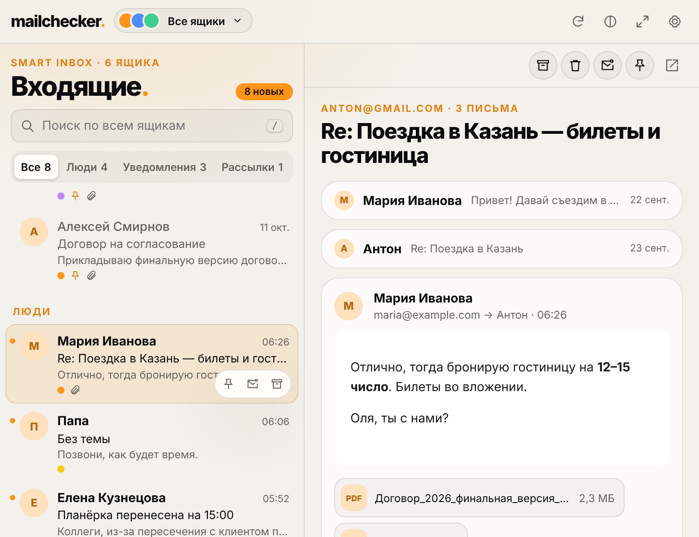
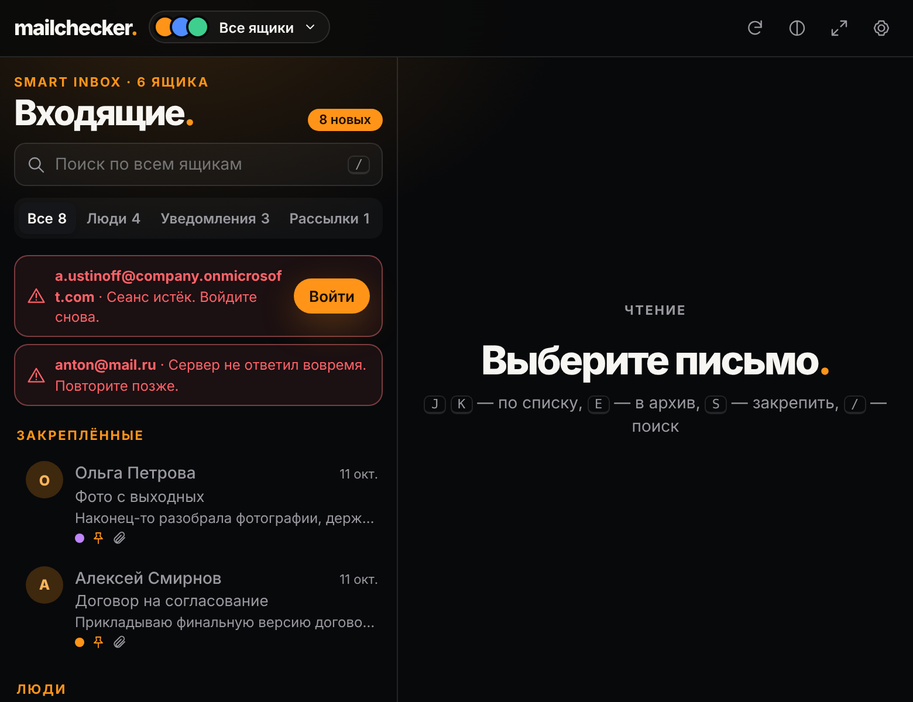
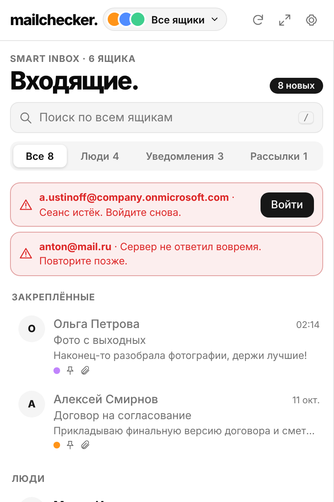
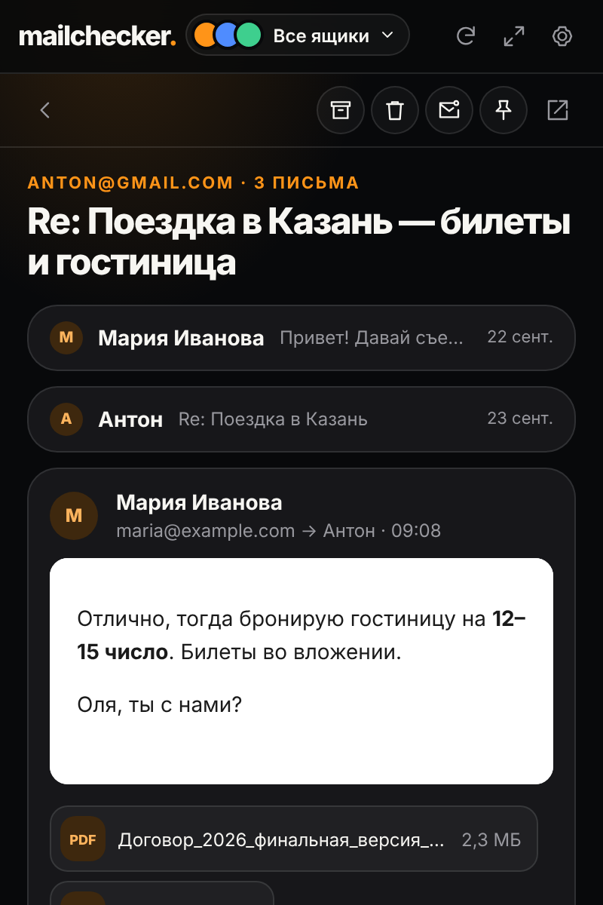
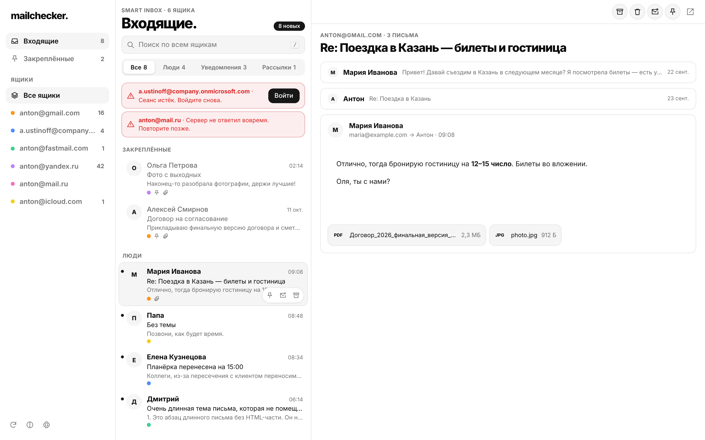
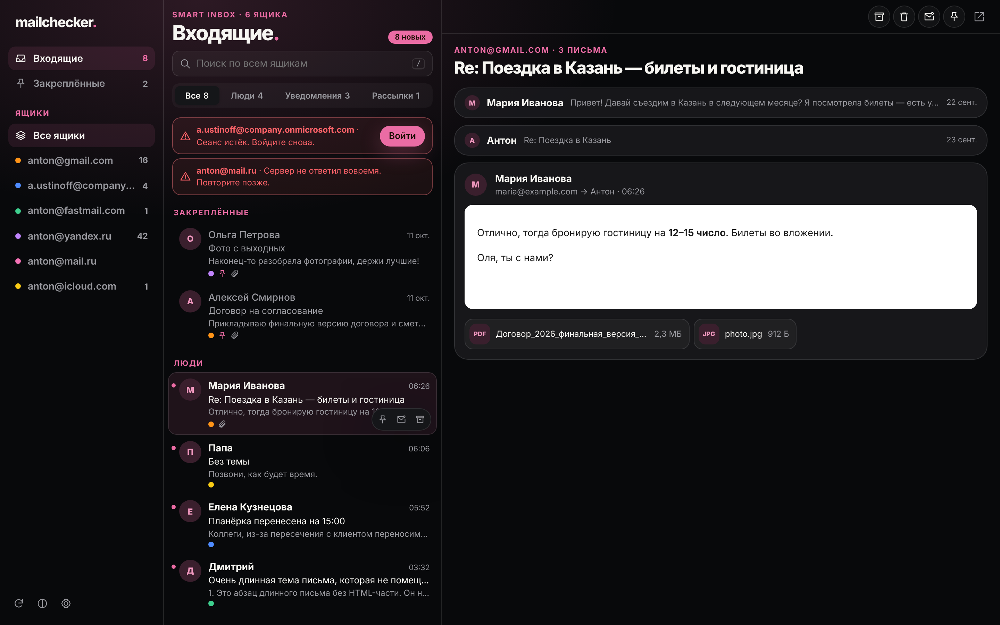
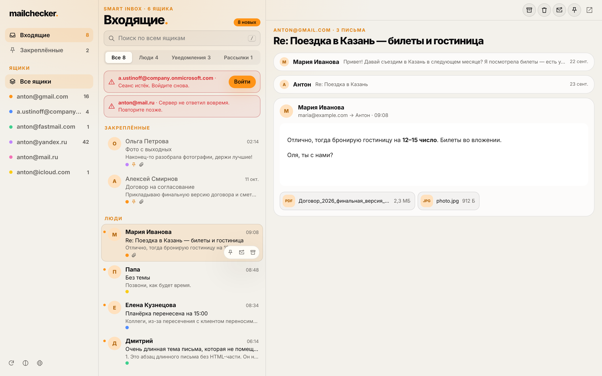
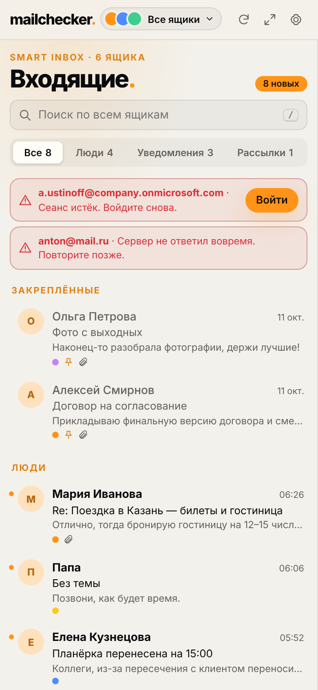
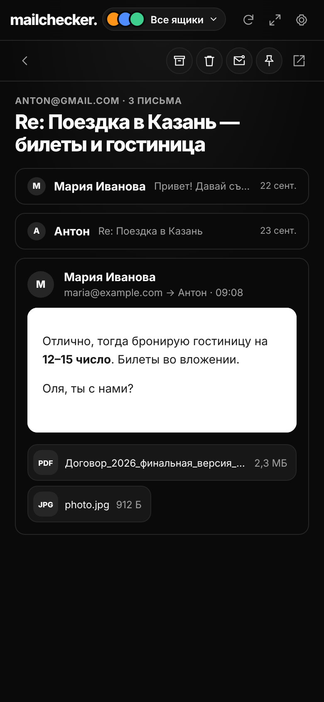
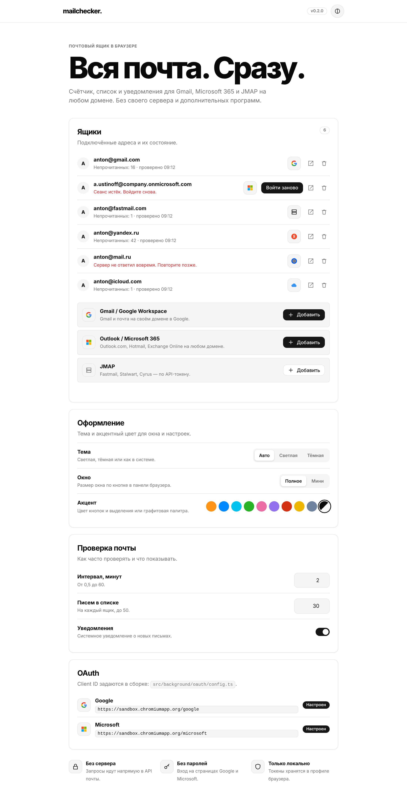

# mailchecker

A mail client that lives in the browser toolbar, for mailboxes on **any domain**: Gmail / Google Workspace, Yandex Mail, Mail.ru, Outlook / Microsoft 365 and JMAP servers such as Fastmail. It runs entirely in the browser: no backend and no companion app (Safari adds a native containing app; see below).

| Provider        | Mailboxes                                                           | Connection                                     |
| --------------- | ------------------------------------------------------------------- | ---------------------------------------------- |
| Gmail           | gmail.com and any domain on Google Workspace                        | The browser's Gmail sign-in, or Google sign-in |
| Yandex Mail     | yandex.ru and Yandex 360 domains                                    | The browser's Yandex sign-in                   |
| Mail.ru         | mail.ru, inbox.ru, list.ru, bk.ru                                   | The browser's Mail.ru sign-in                  |
| Microsoft Graph | Outlook.com, Hotmail, any domain on Microsoft 365 / Exchange Online | Microsoft sign-in                              |
| JMAP            | Fastmail (including custom domains), Stalwart, Cyrus and others     | API token                                      |

**Through the browser's sign-in** nothing is registered or stored: the extension reads the Inbox with the session you already have in this browser, the way the webmail itself does (Gmail's unread feed, Yandex's lite web Inbox, Mail.ru's webmail API). It lists the Inbox and unread count, notifies and shows the full text (Gmail's print view, the Yandex lite message page, the Mail.ru API); Mail.ru marks read and deletes, Yandex deletes and marks read on opening; replies and other actions open the webmail. **Google sign-in** (OAuth) gives the full client for Gmail and needs a client ID in the build (see [OAuth setup](docs/OAUTH.md)). iCloud and other IMAP-only services are planned through the Safari containing app (see [Safari](docs/SAFARI.md)).

## Features

- **Opens from the toolbar:** click the icon for a full client (780×600, or a one-column mini popup 400×600 set in Settings): list, reader and actions without leaving the page. ⤢ opens the same client full screen in a tab.
- **Unified Inbox** across all accounts, with an account switcher and a colour you pick per account.
- **Smart Inbox:** one list newest first with pinned messages on top; «Уведомления» and «Рассылки» filters; repeated notifications (CI failures, alerts) stacked into one `×N` item.
- **Safe reading:** conversations with collapsed history, sanitized HTML in a script-free sandbox, remote images and trackers blocked until you allow them.
- **Actions** synced with the provider: archive, trash, read/unread, pin, reply (in the extension, or in the webmail where no send API exists); search across all accounts; keyboard shortcuts.
- **Responsive:** three columns in a wide tab, two in the popup, one with back navigation on narrow screens and iPhone.
- **Badge and notifications** for new mail; theme (auto/light/dark) and palette (black and white graphite by default, or nine accent colours).
- **Chromium and Safari** from one codebase — see [Safari](docs/SAFARI.md).

## Screenshots

From the sandbox (`npm run sandbox`) on mock mailboxes.

**Toolbar popup (780×600)** in the default black and white palette, light and dark:

<p>
  
  
</p>

**Mini popup (400×600):** one column, the list and a conversation (dark, orange accent):

<p>
  
  
</p>

**Full-screen tab (1440×900):** sidebar, list and reader; light, dark with the pink accent, and the orange accent:





**Phone (390×844):** the list and, in the dark theme, a conversation:

<p>
  
  
</p>

**Settings:** mailboxes, theme, popup size and palette, checks and OAuth:



## Development

Requires Node.js 20.19+ (24 recommended) and Python 3.

```sh
npm ci
npm run build      # build/ → chrome://extensions → Load unpacked
npm run check      # format, lint, typecheck, tests, repository checks
npm run build:safari  # build-safari/ → xcrun safari-web-extension-converter
npm run package    # dist/mailchecker-<version>.zip
npm run sandbox    # client on mock mailboxes at http://127.0.0.1:8080/, no extension needed
npm run test:sandbox  # Playwright checks of the client in the sandbox
```

Releases: add a `## X.Y.Z` section to `CHANGELOG.md`, set the version in `package.json` and `src/manifest.json`, then push a `vX.Y.Z` tag (or run **Release mailchecker** by hand with the version). The workflow verifies the source and publishes the ZIP with its checksum as a GitHub Release; with the `CWS_*` secrets it also submits the package to the Chrome Web Store.

Gmail and Outlook need OAuth client IDs: see [OAuth setup](docs/OAUTH.md). See [Architecture](docs/ARCHITECTURE.md), [Safari](docs/SAFARI.md) and [Privacy](PRIVACY.md). Mockups are in `design/`.

## License

mailchecker is free software under the [GNU General Public License v3.0](LICENSE) (`GPL-3.0-only`). Copyright (C) 2026 Anton Ustinoff.
