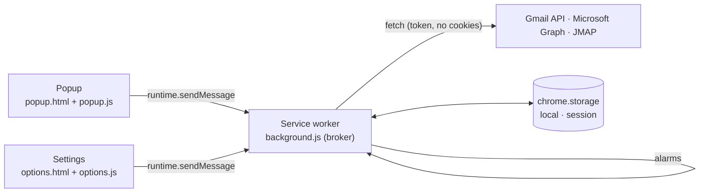

# Architecture

Mail Checker is a Manifest V3 extension with three execution contexts. Each has one TypeScript entry point in `src/`, bundled by esbuild into one classic script in `build/`.

| Context        | Entry                     | Responsibility                                                                |
| -------------- | ------------------------- | ----------------------------------------------------------------------------- |
| Service worker | `src/background/index.ts` | Trusted broker: accounts, tokens, API requests, checks, badge, notifications. |
| Popup          | `src/popup/index.ts`      | Unread summary, account filter, message list and actions. Holds no tokens.    |
| Settings       | `src/options/index.ts`    | Accounts, appearance, check preferences, OAuth status. Requests permissions.  |

`src/shared/` contains side-effect-free modules used by all three: types, preferences, formatting, DOM helpers (`textContent` only) and icons.

## Messages

Pages send a typed `Request` (`src/shared/types.ts`) and receive `{ok: true, value}` or `{ok: false, error}`. The broker accepts only this extension's `popup.html` and `options.html`:

| Type                            | Sender          | Purpose                                                           |
| ------------------------------- | --------------- | ----------------------------------------------------------------- |
| `STATE`                         | popup, Settings | Public state: preferences, accounts without credentials, results. |
| `CHECK`                         | popup, Settings | Check all accounts now.                                           |
| `MARK_READ`, `TRASH`            | popup           | Act on a message from the last check.                             |
| `OPEN`                          | popup, Settings | Open webmail at the Inbox or a message.                           |
| `SIGN_IN`                       | popup, Settings | Interactive OAuth sign-in for an account that needs it.           |
| `PREFERENCES`                   | popup, Settings | Save bounded preferences and reschedule checks.                   |
| `OPTIONS`                       | popup           | Open Settings.                                                    |
| `ADD_ACCOUNT`, `REMOVE_ACCOUNT` | Settings        | Connect or remove a mailbox.                                      |

## Service worker

| Module                 | Role                                                                                                |
| ---------------------- | --------------------------------------------------------------------------------------------------- |
| `index.ts`             | Message router, sender checks, alarm schedule, lifecycle and notification listeners.                |
| `storage.ts`           | Trusted local storage (`TRUSTED_CONTEXTS`) with serialized read-modify-write updates.               |
| `http.ts`              | Bounded JSON requests: HTTPS only, no cookies or redirects, 25 s timeout, 4 MiB limit, `AuthError`. |
| `accounts.ts`          | Provider registry, public state, add/remove, deduplicated token renewal, `withAccount`.             |
| `mailbox.ts`           | Checks, badge, new-message notifications, mark-read/trash/open.                                     |
| `oauth/`               | Public client IDs; Google implicit flow and Microsoft PKCE/refresh with `state` checks.             |
| `providers/message.ts` | The `Provider` contract and bounded message normalization.                                          |
| `providers/gmail.ts`   | Gmail API: Inbox label count, unread list with metadata, modify/trash.                              |
| `providers/outlook.ts` | Microsoft Graph: Inbox unread count, unread messages, PATCH/move.                                   |
| `providers/jmap.ts`    | JMAP session, Mailbox/Email query/get/set; API must share the session origin.                       |

### Stored data

| Area    | Key                                    | Contents                                                         |
| ------- | -------------------------------------- | ---------------------------------------------------------------- |
| local   | `preferences`, `accounts`, `mailboxes` | Preferences; accounts with credentials; last result per account. |
| session | `notification:<id>`                    | Webmail URL for a shown notification.                            |

### Checks and notifications

The `check` alarm runs every `interval` minutes. A check stores `{unread, messages, error, reauth, checkedAt, notified}`. Errors keep the last known list. Notifications cover messages absent from the previous successful check and received within 24 hours, so connecting an account is silent.

### Credentials

Expired tokens are renewed before a call; a token the provider rejects is renewed once and the call retried. Concurrent renewals share one request, and a renewal is discarded if the account was removed or replaced meanwhile. Google renews silently through the browser session (`prompt=none`); Microsoft uses its refresh token; JMAP tokens do not expire and a rejected token needs a new account entry.

## Styles

`src/styles/_tokens.scss` defines two palettes × light/dark as CSS custom properties: `accent` (warm surfaces, orange accent, pill controls) and `neutral` (monochrome graphite, white primary buttons). The root follows the system scheme unless `data-theme` is set; `data-palette` selects the palette. `_components.scss` holds shared controls; `popup.scss` and `options.scss` lay out each page.

## Build and package

1. `npm run build` runs `scripts/build.mjs`: esbuild bundles the three TypeScript entry points (`format: iife`, `target: chrome116`, unminified), Sass compiles SCSS, and the manifest, pages and icons are copied into `build/`.
2. `npm run typecheck` runs `tsc --noEmit` with `strict`.
3. `scripts/package.py` packages `build/` with `PRIVACY.md` into a reproducible `dist/mail-checker-<version>.zip` and its SHA-256.
4. `scripts/check.mjs` validates the manifest, version consistency, strict CSP, the optional `identity` permission, unsafe DOM APIs and the build's referenced files.

## Tests

`npm test` bundles the worker with test client IDs and runs it in a Node.js VM with mocked `chrome.*` APIs and mocked Gmail, Graph, Microsoft login and JMAP servers: connections, counts, notifications, actions, token refresh deduplication, rejected tokens, sender checks, the identity permission and preference bounds. Real sign-in, provider acceptance and installed-Chrome behavior need manual verification.
