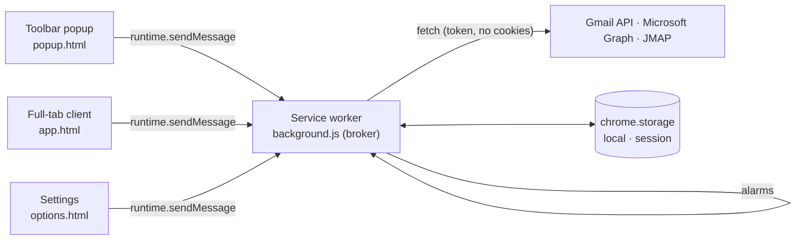

# Architecture

mailchecker is a Manifest V3 mail client that lives in the browser toolbar. It has three execution contexts. Each has one TypeScript entry point in `src/`, bundled by esbuild into one classic script per target (`build/` for Chromium, `build-safari/` for Safari).

| Context        | Entry                     | Responsibility                                                                        |
| -------------- | ------------------------- | ------------------------------------------------------------------------------------- |
| Service worker | `src/background/index.ts` | Trusted broker: accounts, tokens, API requests, checks, badge, notifications.         |
| Client         | `src/client/index.tsx`    | SolidJS mail client for `popup.html` and `app.html`: list, reader, actions, search.   |
| Settings       | `src/options/index.ts`    | Accounts, appearance, check preferences, OAuth status. Requests optional permissions. |

`src/shared/` contains modules used by every context: types, preferences, formatting, DOM helpers, icons, the Inbox model (`inbox.ts`) and email sanitization (`sanitize.ts`, pages only).

## Client

The popup and the full-tab app run the same SolidJS client; `data-mode` on `<html>` tells them apart. The popup's ⤢ button sends `OPEN_APP`, which focuses an existing `app.html` tab or opens one.

### Responsive layout

| Width / context                   | Layout                                   |
| --------------------------------- | ---------------------------------------- |
| Full tab ≥ 1100 px                | Sidebar · list · reader                  |
| Popup (780×600) and tabs 700–1099 | Top bar, then list · reader              |
| < 700 px, or a phone popup (iOS)  | Top bar, then list **or** reader, with ← |

A popup on a phone-sized touch screen sets `data-narrow` and fills the screen instead of the fixed 780×600 window. Row hover actions are hidden on touch screens; the reader toolbar has every action.

| Module                       | Role                                                                                         |
| ---------------------------- | -------------------------------------------------------------------------------------------- |
| `store.ts`                   | Signals: state, account and category filters, selection, stacks, search, conversation cache. |
| `components/TopBar.tsx`      | Logo, account switcher, refresh, theme, full screen (popup), Settings.                       |
| `components/Sidebar.tsx`     | Wide layout: views, accounts, global actions.                                                |
| `components/MessageList.tsx` | Title, search, category filter, Smart Inbox sections, rows, notification stacks, notices.    |
| `components/Reader.tsx`      | Toolbar actions, conversation with collapsed earlier messages, privacy bar, attachments.     |
| `components/MailFrame.tsx`   | Sanitized body in a sandboxed frame sized to its content.                                    |

Keyboard: `J`/`K` or arrows move, `E` archives, `#`/`Delete` trashes, `U` toggles read, `S` pins, `/` searches, `Esc` goes back.

### Smart Inbox

`providers/message.ts#categorize` assigns **people**, **notifications** or **newsletters** from Gmail category labels, `List-Unsubscribe`/`Precedence` headers (Graph: `unsubscribeEnabled`) and automated sender addresses. `shared/inbox.ts` merges accounts newest first, shows pinned messages first and stacks notifications with the same sender and subject into one `×N` item.

### Reading safely

Bodies are untrusted. `shared/sanitize.ts` parses them with `DOMParser`, removes scripts, frames, forms, embeds, `on*` handlers, `javascript:` and other unsafe URLs, opens links in new tabs, and blocks remote images (counting 1×1/hidden ones as trackers) until the user clicks **Показать**. The result is rendered in `<iframe sandbox="allow-same-origin allow-popups allow-popups-to-escape-sandbox">` — no `allow-scripts` — whose own CSP is `default-src 'none'; img-src data:; style-src 'unsafe-inline'`, adding `https:` image and font sources only after the user allows remote content. HTML mail keeps a white paper background; plain text follows the theme.

## Messages

Pages send a typed `Request` (`src/shared/types.ts`) and receive `{ok: true, value}` or `{ok: false, error}`. The broker accepts only this extension's `popup.html`, `app.html` (client) and `options.html` (Settings):

| Type                            | Sender           | Purpose                                                                |
| ------------------------------- | ---------------- | ---------------------------------------------------------------------- |
| `STATE`                         | client, Settings | Public state: preferences, accounts without credentials, Inbox lists.  |
| `CHECK`                         | client, Settings | Check all accounts now.                                                |
| `THREAD`                        | client           | A conversation with bodies; marks the opened message read. Not stored. |
| `ACT`                           | client           | `archive`, `trash`, `read`, `unread`, `pin`, `unpin` one message.      |
| `SEARCH`                        | client           | Search every account; hits merged newest first. Not stored.            |
| `OPEN`                          | client, Settings | Open webmail at the Inbox or a message.                                |
| `OPEN_APP`                      | client           | Open or focus the full-tab client.                                     |
| `SIGN_IN`                       | client, Settings | Interactive OAuth sign-in for an account that needs it.                |
| `PREFERENCES`                   | client, Settings | Save bounded preferences and reschedule checks.                        |
| `OPTIONS`                       | client           | Open Settings.                                                         |
| `ADD_ACCOUNT`, `REMOVE_ACCOUNT` | Settings         | Connect or remove a mailbox.                                           |

## Service worker

| Module                 | Role                                                                                                |
| ---------------------- | --------------------------------------------------------------------------------------------------- |
| `index.ts`             | Message router, sender checks, alarm schedule, lifecycle and notification listeners.                |
| `platform.ts`          | Browser differences (Chromium/Safari): storage access level, badge, notifications, identity, tabs.  |
| `storage.ts`           | Trusted local storage with serialized read-modify-write updates.                                    |
| `http.ts`              | Bounded JSON requests: HTTPS only, no cookies or redirects, 25 s timeout, 4 MiB limit, `AuthError`. |
| `accounts.ts`          | Provider registry, public state, add/remove, deduplicated token renewal, `withAccount`.             |
| `mailbox.ts`           | Checks, badge, notifications, conversations, search and message actions.                            |
| `oauth/`               | Public client IDs; Google implicit flow and Microsoft PKCE/refresh with `state` checks.             |
| `providers/message.ts` | The `Provider` contract, Smart Inbox categories and bounded normalization.                          |
| `providers/gmail.ts`   | Gmail API: Inbox list with labels, MIME bodies, threads, label actions, search.                     |
| `providers/outlook.ts` | Microsoft Graph: Inbox list, conversation messages and attachments, PATCH/move, `$search`.          |
| `providers/jmap.ts`    | JMAP: Mailbox/Email query/get/set, Thread/get with body values, `text` search.                      |

### Stored data

| Area    | Key                                    | Contents                                                                      |
| ------- | -------------------------------------- | ----------------------------------------------------------------------------- |
| local   | `preferences`, `accounts`, `mailboxes` | Preferences; accounts with credentials; latest Inbox list (≤ 50) per account. |
| session | `notification:<id>`                    | Webmail URL for a shown notification.                                         |

Message bodies, attachments metadata and search results stay in page memory (a 30-conversation cache) and are never written to storage.

### Checks and notifications

The `check` alarm runs every `interval` minutes. A check stores `{unread, messages, error, reauth, checkedAt, notified}` where `messages` are the latest Inbox messages, read and unread, and `unread` is the provider's Inbox count. Errors keep the last known list. Notifications cover unread messages absent from the previous successful check and received within 24 hours, so connecting an account is silent.

### Credentials

Expired tokens are renewed before a call; a token the provider rejects is renewed once and the call retried. Concurrent renewals share one request, and a renewal is discarded if the account was removed or replaced meanwhile. Google renews silently through the browser session (`prompt=none`); Microsoft uses its refresh token; JMAP tokens do not expire and a rejected token needs a new account entry.

## Browsers

Chromium browsers load `build/`. Safari loads `build-safari/` inside a containing app; its API gaps (no `identity`, no `notifications`) and the plan for the app are in [Safari](SAFARI.md). All browser-specific calls go through `background/platform.ts`.

## Styles

`src/styles/_tokens.scss` defines two palettes × light/dark as CSS custom properties: `accent` (warm surfaces, orange accent, pill controls) and `neutral` (monochrome graphite, white primary buttons). The root follows the system scheme unless `data-theme` is set; `data-palette` selects the palette. `_components.scss` holds shared controls; `client/client.scss` and `options/options.scss` lay out each page. Design mockups live in `design/`.

## Build and package

1. `npm run build` / `npm run build:safari` runs `scripts/build.mjs`: esbuild bundles the three entry points (`format: iife`, targets Chrome 116 and Safari 16, unminified) with `esbuild-plugin-solid` compiling JSX ahead of time; Sass compiles SCSS; pages and icons are copied and the manifest is adapted per target.
2. `npm run typecheck` runs `tsc --noEmit` with `strict` and Solid's JSX types.
3. `scripts/package.py` packages `build/` with `PRIVACY.md` into a reproducible `dist/mailchecker-<version>.zip` and its SHA-256.
4. `scripts/check.mjs` validates the manifest, version consistency, strict CSP, the optional `identity` permission, unsafe DOM APIs, and both targets' builds (including Safari manifest adaptations and the absence of sandbox fixtures).

## Sandbox

`npm run sandbox` builds `build-sandbox/` with `__SANDBOX__ = true` and serves it at `http://127.0.0.1:8080/` with the extension's CSP. In this build `request()` in `shared/dom.ts` is answered by `src/sandbox/worker.ts` from `src/sandbox/fixtures.ts` instead of `chrome.runtime.sendMessage`, and the client does not subscribe to `chrome.storage`, so `popup.html` and `app.html` run in a plain tab without the extension, accounts or network. Fixtures cover all six provider IDs (including the IMAP-only `yandex`, `mailru` and `icloud`, which have no adapter yet), every Smart Inbox category, a notification stack, pinned mail, attachments, long text, HTML with remote images and a tracker, a conversation, an expired sign-in and a failed check. Actions change in-memory state; a reload resets it. `?theme=` and `?palette=` set the initial preferences. `index.html` shows the popup (780×600) and a phone (390×844) side by side. Release builds define `__SANDBOX__ = false`, and esbuild drops the fixtures.

## Tests

`npm test` runs:

- `background.test.mjs`: the bundled worker in a Node.js VM with mocked `chrome.*` APIs and mocked Gmail, Graph, Microsoft login and JMAP servers — connections, counts, notifications, actions, conversations, search, token refresh deduplication, rejected tokens, sender checks, the identity permission and preference bounds.
- `inbox.test.mjs`: account merging, notification stacks, Smart Inbox sections, counts and categorization.

`npm run test:sandbox` runs `e2e/sandbox.spec.mjs` with Playwright in headless Chromium against the sandbox: every layout (popup 780×600, wide tab, phone popup with touch, phone tab) renders without errors or horizontal scroll and opens a conversation; the keyboard archive, search across archived mail, blocked remote images, sign-in after an expired session and theme parameters work.

Sanitization needs a DOM and is verified in the sandbox; real sign-in, provider acceptance and installed-browser behavior need manual verification.
