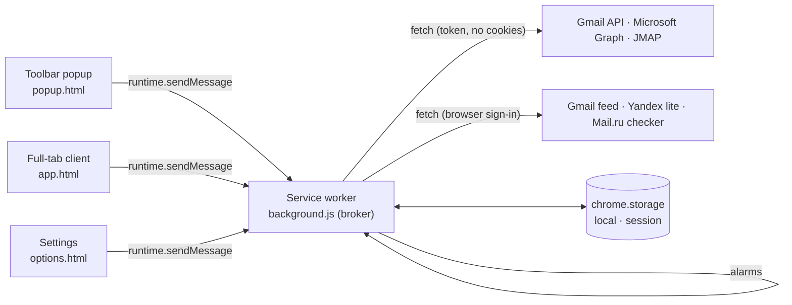

# Architecture

mailchecker is a Manifest V3 mail client that lives in the browser toolbar. It has three execution contexts. Each has one TypeScript entry point in `src/`, bundled by esbuild into one classic script per target (`build/` for Chromium, `build-safari/` for Safari).

| Context        | Entry                     | Responsibility                                                                        |
| -------------- | ------------------------- | ------------------------------------------------------------------------------------- |
| Service worker | `src/background/index.ts` | Trusted broker: accounts, tokens, API requests, checks, badge, notifications.         |
| Client         | `src/client/index.tsx`    | SolidJS mail client for `popup.html` and `app.html`: list, reader, actions, search.   |
| Settings       | `src/options/index.ts`    | Accounts, appearance, check preferences, OAuth status. Requests optional permissions. |

`src/shared/` contains modules used by every context: types, preferences, formatting, DOM helpers, icons, the Inbox model (`inbox.ts`) and email sanitization (`sanitize.ts`, pages only).

## Client

The popup and the full-tab app run the same SolidJS client; `data-mode` on `<html>` tells them apart. The popup's ⤢ button sends `OPEN_APP`, which focuses an existing `app.html` tab or opens one.

The list title opens a folder selector. Catalogs are requested on its first opening, and message pages only when a folder is selected. Selecting an account returns to its Inbox; All mailboxes defaults to the unified Inbox. Common Sent, Archive, Trash, Spam and Drafts views merge folders by server role, while custom folders remain separate and show their account address. A failed account is reported without dropping successful accounts' results. Pages contain at most 50 messages per account and expose an explicit Load more action. Folder metadata and message pages stay in page memory, never in storage; alarms, notification baselines and the badge continue to use only the Inbox. Manual refresh also reloads the selected folder. Changing accounts or folders discards late page responses.

`FOLDERS` and `FOLDER` are client-only worker requests. Catalog IDs, names, roles and pages are bounded in the worker, and provider adapters keep request hosts fixed. `THREAD`, `ACT`, `REPLY` and `OPEN` may carry public message metadata for a folder entry outside the stored Inbox; the worker normalizes it and never allows it to replace a known Inbox record. No credentials are accepted from these pages. Trash browsing does not add permanent deletion. Folder-role metadata comes from Gmail system labels, Graph well-known IDs, JMAP mailbox roles, Yandex lite navigation paths and Mail.ru folder types/archive flags, rather than guessing from translated custom names.

Gmail connected through the browser's unread Atom feed does not provide a full folder catalog or read-message pages. That connection reports folder browsing as unavailable; full Gmail folder browsing uses the existing OAuth/API connection. Yandex and Mail.ru use the same verified browser session as their Inbox adapters. Their webmail markup/API is not a public contract and needs installed-browser verification.

Folder counters use server totals from Gmail label metadata, Graph folder item counts, JMAP `totalEmails` and Mail.ru `messages_total`. Yandex lite exposes unread counts instead of totals. Gmail's virtual Archive uses `resultSizeEstimate`. Common exact counts require every corresponding count; when only some exact totals are available their sum covers only those mailboxes. Oval badges contain numbers only; localized tooltips and accessible labels explain unread, approximate and partial counts. Unavailable counts are hidden, and an incomplete estimated total is never presented as a partial count. Catalog counters are refreshed on the next selector opening after a mail-state change, without downloading folder contents.

### Responsive layout

| Width / context                                        | Layout                                   |
| ------------------------------------------------------ | ---------------------------------------- |
| Full tab ≥ 1100 px                                     | Sidebar · list · reader                  |
| Popup (780×600) and tabs 700–1099                      | Top bar, then list · reader              |
| < 700 px, mini popup (400×600), or a phone popup (iOS) | Top bar, then list **or** reader, with ← |

In two-column layouts the boundary between the list and reader can be dragged horizontally, or adjusted with the left/right arrow keys when focused. Its range keeps at least 320 px for the reader; the top bar uses fixed columns and stays in place. The chosen width lasts for the current page, and the divider is hidden in one-column layouts.

The `popup` preference (`full` or `mini`, set in Settings) sets `data-size` on the popup root; the mini popup is 400×600, narrow enough for the one-column layout. A popup on a phone-sized touch screen sets `data-narrow` and fills the screen instead of the fixed 780×600 window. Row hover actions are hidden on touch screens; the reader toolbar has every action.

| Module                       | Role                                                                                         |
| ---------------------------- | -------------------------------------------------------------------------------------------- |
| `store.ts`                   | Signals: state, account and category filters, selection, stacks, search, conversation cache. |
| `components/TopBar.tsx`      | Logo, account switcher, refresh, theme, full screen (popup), Settings.                       |
| `components/Sidebar.tsx`     | Wide layout: views, accounts, global actions.                                                |
| `components/MessageList.tsx` | Title, search, category filter, Smart Inbox sections, rows, notification stacks, notices.    |
| `components/PaneDivider.tsx` | Bounded pointer and keyboard resizing of the list, below the fixed top bar.                  |
| `components/Reader.tsx`      | Toolbar actions, conversation with collapsed earlier messages, privacy bar, attachments.     |
| `components/MailFrame.tsx`   | Sanitized body in a sandboxed frame sized to its content.                                    |

Keyboard: `J`/`K` or arrows move, `E` archives, `#`/`Delete` trashes, `U` toggles read, `S` pins, `/` searches, `Esc` goes back.

The open message keeps its last known metadata in page memory when it leaves the visible list. Reader actions use the selected account and message ID independently of list visibility; new public state supplies fresh metadata whenever the message is still listed. Clearing the selection releases the retained entry. Conversation caches are invalidated when Inbox content metadata changes or a reply is sent; the open reader refreshes with the new cache generation while keeping its loaded body visible. Loading placeholders are used only when no body is available for the selected message; previously loaded content is never reused for a different selection. Reopening unread mail performs a new thread request. Successful read state returned with a conversation also updates matching search hits.

### Smart Inbox

`providers/message.ts#categorize` assigns **people**, **notifications** or **newsletters** from Gmail category labels, `List-Unsubscribe`/`Precedence` headers (Graph: `unsubscribeEnabled`) and automated sender addresses. `shared/inbox.ts` merges accounts newest first into one list (pinned messages first; «Уведомления» and «Рассылки» filter by category) and stacks notifications with the same sender and subject into one `×N` item.

### Reading safely

Bodies are untrusted. `shared/sanitize.ts` parses them with `DOMParser`, removes scripts, frames, forms, embeds, `on*` handlers, `javascript:` and other unsafe URLs, opens links in new tabs, and blocks remote images (counting 1×1/hidden ones as trackers) until the user clicks **Показать**. The result is rendered in `<iframe sandbox="allow-same-origin allow-popups allow-popups-to-escape-sandbox">` — no `allow-scripts` — whose own CSP is `default-src 'none'; img-src data:; style-src 'unsafe-inline'`, adding `https:` image and font sources only after the user allows remote content. HTML mail keeps a white paper background; plain text follows the theme.

## Messages

Pages send a typed `Request` (`src/shared/types.ts`) and receive `{ok: true, value}` or `{ok: false, error}`. The broker accepts only this extension's `popup.html`, `app.html` (client) and `options.html` (Settings):

| Type                            | Sender           | Purpose                                                                |
| ------------------------------- | ---------------- | ---------------------------------------------------------------------- |
| `STATE`                         | client, Settings | Public state: preferences, accounts without credentials, Inbox lists.  |
| `CHECK`                         | client, Settings | Check all accounts now.                                                |
| `THREAD`                        | client           | A conversation with bodies; marks the opened message read. Not stored. |
| `ACT`                           | client           | `archive`, `trash`, `read`, `unread`, `pin`, `unpin` one message.      |
| `SEARCH`                        | client           | Search every account; hits merged newest first. Not stored.            |
| `OPEN`                          | client, Settings | Open webmail at the Inbox or a message.                                |
| `OPEN_APP`                      | client           | Open or focus the full-tab client.                                     |
| `SIGN_IN`                       | client, Settings | OAuth sign-in, or open the connected browser-session webmail.          |
| `PREFERENCES`                   | client, Settings | Save bounded preferences and reschedule checks.                        |
| `OPTIONS`                       | client           | Open Settings.                                                         |
| `ADD_ACCOUNT`, `REMOVE_ACCOUNT` | Settings         | Connect or remove a mailbox.                                           |
| `ACCOUNT_COLOR`                 | Settings         | Set a mailbox colour from `ACCOUNT_COLORS` (empty: by position).       |
| `REPLY`                         | Client           | Send a plain-text reply; accounts without `reply` open the webmail.    |

## Service worker

| Module                                            | Role                                                                                                                                                                                                                   |
| ------------------------------------------------- | ---------------------------------------------------------------------------------------------------------------------------------------------------------------------------------------------------------------------- |
| `index.ts`                                        | Message router, sender checks, alarm schedule, lifecycle and notification listeners.                                                                                                                                   |
| `platform.ts`                                     | Browser differences (Chromium/Safari): storage access level, badge, notifications, identity, tabs.                                                                                                                     |
| `storage.ts`                                      | Trusted local storage with serialized read-modify-write updates.                                                                                                                                                       |
| `http.ts`                                         | Bounded JSON and text requests: HTTPS only, no cookies or redirects, eight concurrent requests, 25 s network timeout, 4 MiB limit, `AuthError`; `session` requests send the browser's cookies to `SESSION_HOSTS` only. |
| `accounts.ts`                                     | Provider registries (API and browser sign-in; `settings.browser` picks one), public state, add/remove, deduplicated token renewal, `withAccount`.                                                                      |
| `mailbox.ts`                                      | Checks, badge, notifications, conversations, search and message actions.                                                                                                                                               |
| `oauth/`                                          | Public client IDs; Google implicit flow and Microsoft PKCE/refresh with `state` checks.                                                                                                                                |
| `providers/message.ts`                            | The `Provider` contract, Smart Inbox categories and bounded normalization.                                                                                                                                             |
| `providers/gmail.ts`                              | Gmail API: Inbox list with labels, MIME bodies, threads, label actions, search.                                                                                                                                        |
| `providers/outlook.ts`                            | Microsoft Graph: Inbox list, conversation messages and attachments, PATCH/move, `$search`.                                                                                                                             |
| `providers/jmap.ts`                               | JMAP: Mailbox/Email query/get/set, Thread/get with body values, `text` search.                                                                                                                                         |
| `providers/session.ts`                            | Mailboxes read through the browser's sign-in: no credentials; the Inbox, the full text and the actions each webmail supports, the rest in the webmail.                                                                 |
| `providers/gmailweb.ts`, `yandex.ts`, `mailru.ts` | Gmail unread Atom feed, Yandex lite Inbox page, Mail.ru webmail API; parsers are pure and tested.                                                                                                                      |

### Stored data

| Area    | Key                                    | Contents                                                                                                                                 |
| ------- | -------------------------------------- | ---------------------------------------------------------------------------------------------------------------------------------------- |
| local   | `preferences`, `accounts`, `mailboxes` | Preferences; accounts with credentials; latest Inbox list (≤ 50) per account.                                                            |
| session | `notification:<id>`                    | Up to 100 recent notification URLs and their bounded `notification-index`; removed on click/dismissal, oldest-first eviction or restart. |

The chosen next cache/search design is specified in [Search and cache decision](SEARCH_AND_CACHE.md); persistent IndexedDB caching is proposed there and is not implemented by these audit fixes.

Message bodies, attachments metadata, folder catalogs/pages and search results stay in page memory (a 30-conversation cache) and are never written to storage. Catalog requests are deduplicated per account, so changing the selected mailbox does not suppress its load. Counter catalogs expire after 30 seconds and become dirty after relevant Inbox changes or local actions; timestamp-only checks preserve their freshness. Gmail counter reads use multipart batches of at most 50 operations through the same bounded HTTP layer. Individual missing counts remain unknown without hiding folder names. Graph folder catalogs follow same-origin, same-path continuations within the existing 200-folder/request bounds. Parent paths are indexed and computed once before sorting.

An in-flight folder page is reconciled with successful mutations made after its request began. Concurrent read/pin actions patch only confirmed fields of the latest records and reconcile the Inbox unread total. Folder refresh reloads counter catalogs and rebinds the active choice; failed counters are marked partial. Conversation invalidation compares per-message content metadata and deletes only affected account/thread keys, leaving unrelated readers and cached bodies intact. Gmail/JMAP archive preserves custom-folder memberships and the current row; Outlook moves the row to Archive. Search actions and pagination are independent of the previously selected folder. Search via browser-session accounts remains a webmail capability: the client identifies those excluded addresses, and an entirely unsupported search does not claim that no matching messages exist. Transient body errors propagate and clear the failed conversation cache entry so reopening can retry.

Unread headings use provider totals instead of the bounded loaded list. Category counts cover loaded entries and expose a lower-bound tooltip when the full unread set is not present. `unreadPartial` marks an Inbox count as a lower bound when an authoritative total is unavailable; a full Mail.ru unread page reads the Inbox total from folder metadata. Known folder counters are adjusted after local reads/moves and refreshed on the next catalog load. Yandex lite rows without machine-readable dates use nonpositive server-order values, including a page offset; Yandex cursors carry a server page plus an intra-page offset so the client consumes every parsed row before advancing; the interface leaves their date blank instead of presenting a check time as a received date.

### Search support and limits

Search is global across connected accounts and independent of the selected folder. The current worker requests at most 20 hits per API account and merges successful replies by date. A total failure rejects the search, while partial successes remain available. The client uses request generations, preserves a persistent retryable error on failure and ignores stale successes, errors and loading completions; it does not paginate search results. Query syntax is provider-specific rather than a shared advanced-search language:

- Gmail API sends the query as `users.messages.list.q`, using the existing `gmail.modify` scope. The documented `gmail.metadata` restriction therefore does not apply. The adapter does not set `includeSpamTrash`, so Spam/Trash are excluded by default; the API does not perform all of Gmail UI's alias expansion or thread-wide matching. See [messages.list](https://developers.google.com/workspace/gmail/api/reference/rest/v1/users.messages/list) and [Gmail search differences](https://developers.google.com/workspace/gmail/api/guides/filtering).
- Microsoft Graph sends `$search` to `/me/messages`, with `$top=20`. Unqualified text targets sender, subject and body; Graph supports its documented property/KQL syntax and a service ceiling of 1,000 search results, distinct from the extension's smaller request limit. See [Graph message search](https://learn.microsoft.com/en-us/graph/search-query-parameter?tabs=http#use-search-on-message-collections).
- JMAP sends `Email/query` with a `text` filter, without `inMailbox`, and a limit of 20. Matching follows the server's RFC-defined text-search rules. See [RFC 8621 section 4.4.1](https://www.rfc-editor.org/rfc/rfc8621.html#section-4.4.1).

The current Gmail browser-session, Yandex and Mail.ru adapters do not implement remote search. Their explicit exclusion notice is an extension capability limit, not a claim that those services cannot search. Browser-session Gmail is distinct from Gmail API. Official [Yandex client documentation](https://yandex.ru/support/yandex-360/business/admin/ru/mail/email-clients/) and [Mail.ru client documentation](https://help.mail.ru/mail/login/mailer/) document IMAP/SMTP access; these do not define a public HTTP mailbox-search contract for the browser-session endpoints this extension currently uses. No unsupported search endpoint is inferred or requested. Use webmail search for these connections.

### Checks and notifications

The `check` alarm runs every `interval` minutes. A check stores `{unread, messages, error, reauth, checkedAt, notified}` and optional `unreadPartial`, where `messages` are the latest Inbox messages, read and unread, and `unread` is the provider's Inbox count. Gmail and Mail.ru browser feeds declare `unreadOnly`: checks merge their unread results with known read metadata, newest first within the configured list limit. Read mail therefore survives refreshes and reopening the client; archive and trash remove it explicitly. The unread count still comes from the provider feed. Errors keep the last known list. Transient per-account mutation generations prevent a successful or failed in-flight check from overwriting an action. Notifications cover unread messages absent from the previous successful check and received within 24 hours, so connecting an account is silent. Messages with unknown dates can notify only when first seen after that baseline.

### Credentials

Expired tokens are renewed before a call; a token the provider rejects is renewed once and the call retried. Explicit API quota and permission reasons on a 403 response do not trigger renewal or reauthentication; this also applies to Gmail multipart counter replies. A bare legacy 403 without an identifiable reason retains the credential-rejection fallback. Concurrent renewals share one request, and a renewal is discarded if the account was removed or replaced meanwhile. Google renews silently through the browser session (`prompt=none`); Microsoft uses its refresh token; JMAP tokens do not expire and a rejected token needs a new account entry.

Before replacing Gmail or Outlook credentials, the worker reads the authenticated mailbox address through the provider's `address` callback and compares it with the connected address. A mismatch rejects both interactive sign-in and silent renewal without storing the new credentials.

Outlook conversation loading follows same-origin `/me/messages` continuations, deduplicates IDs and sorts the completed result locally. Four pages of at most 50 messages bound the load; a repeated continuation or an outstanding continuation at that limit fails explicitly instead of returning a truncated conversation. If the selected ID is absent, it is fetched directly and its conversation ID is verified.

JMAP archive patches only the Inbox and Archive memberships, preserving other folders. Trash replaces memberships with Trash. Message actions update local state only after `Email/set` acknowledges the target ID in `updated`; a per-record `notUpdated` result or a missing acknowledgement fails the action. Replies similarly require nonempty server IDs for both `Email/set.created.draft` and `EmailSubmission/set.created.send`, with no corresponding `notCreated` entry; this confirms server acceptance, not eventual delivery.

Gmail browser requests check the feed owner before using the current session. Yandex checks the lite page's account header, including the active account menu's accessible login name (its visible first letter is separately formatted), and normalizes documented dot/dash and public-domain aliases; missing or mismatched identity raises an authentication error rather than trusting the entered address or a message sender. Browser-session SIGN_IN first verifies the current session. A successful check clears the stale error immediately; only an account still needing authentication opens webmail. Settings and the full-tab client register a single check when the user returns to the visible page; reopening the popup also checks a recent browser-session authentication error. Credentials stay intact, and successful status is shown only after the mailbox check succeeds. Session body loading propagates authentication errors. Yandex deletion verifies that the selected provider ID disappears from its source folder page and appears on an owner-verified Trash page. An HTTP 200 action response alone is insufficient; if the moved message is outside the loaded Trash page or the verification fails, the action reports an error and retains local state rather than claiming success. No automatic destructive retry is performed. Yandex and Mail.ru declare that loading a body marks it read, so the worker reconciles that result without sending a duplicate read operation. Other unread messages, including search hits outside the Inbox cache, are marked read through their provider action before the thread reply returns.

MIME traversal uses an explicit stack, at most 2,000 parts and depth 64; excessive work fails explicitly. Session block scanning advances over complete quote-aware tags, comments and raw-text elements with exact tag-name boundaries. Remote image candidates in `srcset` are counted even when `src` is a data URL, and remain blocked by sanitization and frame CSP until consent.

Notification URL/index updates are serialized, capped at 100 records and cleaned on click or the feature-detected closed event. A one-time legacy migration prunes older records. Storage/notification failures do not fail mail checks.

## Browsers

Chromium browsers load `build/`. Safari loads `build-safari/` inside a containing app; its API gaps (no `identity`, no `notifications`) and the plan for the app are in [Safari](SAFARI.md). All browser-specific calls go through `background/platform.ts`.

## Localization

Interface strings live in `src/_locales/<locale>/messages.json` (13 locales, `en` is the default) and are read through `shared/i18n.ts`: `t(key, ...values)` for `$1`…`$9` substitutions, `tn(key, count)` for counted strings (`key_one`, `key_few`, `key_many`, `key_other`, chosen with `Intl.PluralRules`) and `localize()` for `data-i18n` attributes in static HTML. The browser picks the locale from its language. The worker localizes its error messages the same way. Without `chrome.i18n` (the sandbox and unit tests) the Russian messages are read from `sandbox/messages.ts`; release builds replace that module with an empty one. `scripts/check.mjs` checks that every locale has the English keys and that every key used in code exists. Dates and sizes use `Intl` with the interface language. In the dark theme `sanitize.ts` adapts each colour of an HTML message (light backgrounds darker, dark text lighter) instead of inverting the page.

## Styles

`src/styles/_tokens.scss` defines two palettes × light/dark as CSS custom properties: `accent` (warm surfaces, an accent colour, pill controls) and `neutral` (monochrome graphite, white primary buttons). The root follows the system scheme unless `data-theme` is set; `data-palette` selects the palette. The `palette` preference is `neutral` (black and white graphite, the default; also set on the pages' `<html>` so nothing flashes before preferences load) or one of nine accents: `orange`, `blue`, `cyan`, `green`, `pink`, `purple`, `red`, `yellow`, `gray`. Their colours live in `accents` in `shared/preferences.ts`: `applyTheme` sets `--accent` and `data-accent` on the root, the accent tokens are mixed from `--accent`, and the worker colours the unread badge with it (graphite for `neutral`). Inter ships in `src/fonts/` (variable weight, Latin and Cyrillic subsets, SIL OFL 1.1 in `OFL.txt`) and is declared in `_tokens.scss`, so layouts measure the same on every system. `_components.scss` holds shared controls; `client/client.scss` and `options/options.scss` lay out each page. Design mockups live in `design/`.

## Build and package

1. `npm run build` / `npm run build:safari` runs `scripts/build.mjs`: esbuild bundles the three entry points (`format: iife`, targets Chrome 116 and Safari 16, unminified) with `esbuild-plugin-solid` compiling JSX ahead of time; Sass compiles SCSS; pages and icons are copied and the manifest is adapted per target.
2. `npm run typecheck` runs `tsc --noEmit` with `strict` and Solid's JSX types.
3. `scripts/package.py` packages `build/` with `PRIVACY.md` into a reproducible `dist/mailchecker-<version>.zip` and its SHA-256.
4. `scripts/check.mjs` validates the manifest, version consistency, strict CSP, the optional `identity` permission, unsafe DOM APIs, and both targets' builds (including Safari manifest adaptations and the absence of sandbox fixtures).

## Sandbox

`npm run sandbox` builds `build-sandbox/` with `__SANDBOX__ = true` and serves it at `http://127.0.0.1:8080/` with the extension's CSP. In this build `request()` in `shared/dom.ts` is answered by `src/sandbox/worker.ts` from `src/sandbox/fixtures.ts` instead of `chrome.runtime.sendMessage`, and the client does not subscribe to `chrome.storage`, so `popup.html` and `app.html` run in a plain tab without the extension, accounts or network. Fixtures cover all six provider IDs (including the IMAP-only `yandex`, `mailru` and `icloud`, which have no adapter yet), every Smart Inbox category, a notification stack, pinned mail, attachments, long text, HTML with remote images and a tracker, a conversation, an expired sign-in and a failed check. Actions change in-memory state, and opening a conversation marks its selected message read; a reload resets it. The reauth=yandex query parameter supplies a browser-session sign-in error for UI regression checks; session=valid and session=after-return cover an already authenticated browser and completion after returning from webmail. refresh=slow simulates changing lite-page timestamps and a delayed conversation response for reader-refresh checks. `?theme=`, `?palette=` and `?popup=` set the initial preferences. `index.html` shows the popup (780×600) and a phone (390×844) side by side. Release builds define `__SANDBOX__ = false`, and esbuild drops the fixtures.

## Tests

`npm test` runs:

- `providers.test.mjs`: audit #7 provider regressions for stable unknown dates, validated root/child continuations, Gmail multipart boundaries/count failures/authentication, honest Mail.ru totals, bounded nested folder ordering, retryable session bodies and documented API search parameters.
- `background.test.mjs`: the bundled worker in a Node.js VM with mocked browser APIs and provider responses — connections, counts, notifications, actions, conversations, search, token renewal, sender checks and preference bounds; audit regressions verify OAuth/browser mailbox ownership, JMAP membership and acknowledgements, delayed checks, search-hit read actions, unread-only feed persistence and browser-session sign-in navigation.
- `client.test.mjs`: the real Solid store with only its worker transport replaced — conversation freshness after refresh/reply, unread reopening, late response isolation, search-flag reconciliation and retained reader metadata.
- `inbox.test.mjs`: account merging, notification stacks, Smart Inbox sections, counts and categorization.

`npm run test:sandbox` runs `e2e/sandbox.spec.mjs` with Playwright in headless Chromium against the sandbox: every layout (popup 780×600, wide tab, phone popup with touch, phone tab) renders without errors or horizontal scroll and opens a conversation; the keyboard archive, search across archived mail, blocked remote images, sign-in after an expired session and theme parameters work. Audit regressions also cover the mini popup, empty searches/categories, read rows and reader actions after checks, avatar/dot alignment, newsletter frame overflow, stable frame shrinkage and ResizeObserver errors, fixed headers during divider resizing, browser-session sign-in buttons and the Settings footer. Settings tests supply only the browser APIs unavailable on localhost; webmail navigation is recorded without opening real accounts.

`rendering.test.mjs` exercises actual CSS adaptation and session block parsing, including synthetic large inputs in isolated workers with a two-second regression budget. Client regressions also cover folder responses racing all six message actions and retained list identities. Browser regressions verify unchanged iframe documents across checks in every layout, theme changes and sidebar/control alignment. CSS image URLs in inline styles and stylesheets are counted for the existing remote-image permission control without weakening the frame CSP.

Sanitization needs a DOM and is verified in the sandbox; real sign-in, provider acceptance and installed-browser behavior need manual verification.
